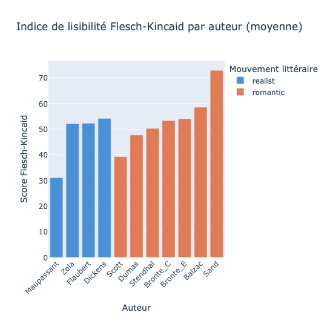
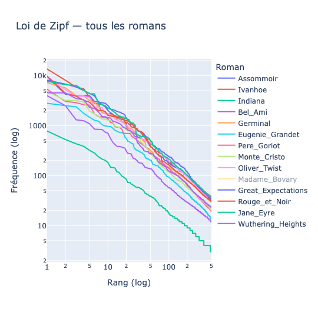

```{r}
#reticulate::use_python("/Library/Frameworks/Python.framework/Versions/3.13/bin/python3", required = TRUE)
python_path <- ifelse(Sys.which("python3") != "", Sys.which("python3"), Sys.which("python"))
reticulate::use_python(python_path, required = TRUE)
# compatibilité mac et windows
```

```{python}
import sparknlp
from sparknlp.base import DocumentAssembler
from sparknlp.annotator import SentenceDetector, Tokenizer
from pyspark.ml import Pipeline
from pathlib import Path
from pyspark.sql.types import StructType, StructField, StringType

spark = sparknlp.start()
print("Spark-NLP:", sparknlp.version())
print("Spark:", spark.version)
```

```{r}
reticulate::py_require("requests")
reticulate::py_config()
```

# Introduction

## Corpus et pipeline d'extraction

Le corpus est composé de 14 romans du XIXe siècle répartis en deux mouvements littéraires : le **Romantisme** et le **Réalisme**. 
Les textes ont été téléchargés depuis [Project Gutenberg](https://www.gutenberg.org/).

## Téléchargement des textes

Le pipeline ETL télécharge automatiquement les romans depuis Project Gutenberg 
et supprime les en-têtes et pieds de page ajoutés par Gutenberg. 
Les fichiers sont sauvegardés dans le dossier `DATA/` qui n'est pas commité 
dans le dépôt git.

```{python}
import requests
import re
import time
from pathlib import Path

GUTENBERG_URL = "https://www.gutenberg.org/cache/epub/{id}/pg{id}.txt"

# La liste des romans à télécharger
CORPUS = [
    {"author": "Balzac",     "title": "Pere_Goriot",            "id": 1237,  "movement": "romantic", "lang": "fr"},
    {"author": "Balzac",     "title": "Eugenie_Grandet",         "id": 1608,  "movement": "romantic", "lang": "fr"},
    {"author": "Dumas",      "title": "Monte_Cristo",            "id": 17989, "movement": "romantic", "lang": "fr"},
    {"author": "Stendhal",   "title": "Rouge_et_Noir",           "id": 798,   "movement": "romantic", "lang": "fr"},
    {"author": "Sand",       "title": "Indiana",                 "id": 5837,  "movement": "romantic", "lang": "fr"},
    {"author": "Bronte_C",   "title": "Jane_Eyre",               "id": 1260,  "movement": "romantic", "lang": "en"},
    {"author": "Bronte_E",   "title": "Wuthering_Heights",       "id": 768,   "movement": "romantic", "lang": "en"},
    {"author": "Scott",      "title": "Ivanhoe",                 "id": 82,    "movement": "romantic", "lang": "en"},
    {"author": "Flaubert",   "title": "Madame_Bovary",           "id": 2413,  "movement": "realist",  "lang": "fr"},
    {"author": "Zola",       "title": "Germinal",                "id": 5711,  "movement": "realist",  "lang": "fr"},
    {"author": "Zola",       "title": "Assommoir",               "id": 8600,  "movement": "realist",  "lang": "fr"},
    {"author": "Dickens",    "title": "Great_Expectations",      "id": 1400,  "movement": "realist",  "lang": "en"},
    {"author": "Dickens",    "title": "Oliver_Twist",            "id": 730,   "movement": "realist",  "lang": "en"},
    {"author": "Maupassant", "title": "Bel_Ami",                 "id": 4598,  "movement": "realist",  "lang": "fr"},
]

def clean_gutenberg(text):
    #Supprime le header et footer ajoutés par Gutenberg.
    start = re.search(r"\*\*\* START OF TH(IS|E) PROJECT GUTENBERG", text)
    end   = re.search(r"\*\*\* END OF TH(IS|E) PROJECT GUTENBERG",   text)
    if start and end:
        text = text[start.end():end.start()]
    return text.strip()

def download_all(data_dir="DATA/"):
    #Télécharge et sauvegarde dans DATA/.
    for book in CORPUS:
        path = Path(data_dir) / book["author"] / f"{book['title']}.txt"
        path.parent.mkdir(parents=True, exist_ok=True)

        if path.exists():
            print(f"[cache] {book['title']}")
            continue

        url = GUTENBERG_URL.format(id=book["id"])
        response = requests.get(url, timeout=30)
        text = clean_gutenberg(response.text)

        path.write_text(text, encoding="utf-8")
        print(f"[ok] {book['title']} — {len(text):,} caractères")

        time.sleep(1)  # pause pour ne pas surcharger Gutenberg

download_all()
```


```{bash}
#head -5 "DATA/Balzac/Pere_Goriot.txt"
#head -5 "DATA/Flaubert/Madame_Bovary.txt"
```

# Chargement et transformation

## Construction du DataFrame Spark

Les textes sont chargés dans un Spark DataFrame avec les métadonnées associées à chaque roman (auteur, mouvement littéraire, langue).

```{python}
from pathlib import Path
from pyspark.sql.types import StructType, StructField, StringType

DATA_DIR = "DATA/"

# apparemment réutiliser CORPUS c'est mieux
corpus_index = {book["title"]: book for book in CORPUS}

rows=[]
for author_dir in Path(DATA_DIR).iterdir():
  author = author_dir.name
  for txt_file in author_dir.glob("*.txt"):
    title = txt_file.stem
    text = txt_file.read_text(encoding="utf-8")
    meta = corpus_index[title]
    rows.append((author, title, meta["movement"], meta["lang"], text))
    
schema = StructType([
  StructField("author", StringType(), True),
  StructField("title", StringType(), True),
  StructField("movement", StringType(), True),
  StructField("lang", StringType(), True),
  StructField("text", StringType(), True),
])

df = spark.createDataFrame(rows, schema=schema)
df.printSchema()
df.select("author", "title", "movement", "lang").show()

""" metadata = {
    "Pere_Goriot":         {"movement": "romantic", "lang": "en"},
    "Eugenie_Grandet":     {"movement": "romantic", "lang": "en"},
    "Monte_Cristo":        {"movement": "romantic", "lang": "en"},
    "Rouge_et_Noir":       {"movement": "romantic", "lang": "en"},
    "Indiana":             {"movement": "romantic", "lang": "en"},
    "Jane_Eyre":           {"movement": "romantic", "lang": "en"},
    "Wuthering_Heights":   {"movement": "romantic", "lang": "en"},
    "Ivanhoe":             {"movement": "romantic", "lang": "en"},
    "Madame_Bovary":       {"movement": "realist",  "lang": "en"},
    "Germinal":            {"movement": "realist",  "lang": "en"},
    "Assommoir":           {"movement": "realist",  "lang": "en"},
    "Great_Expectations":  {"movement": "realist",  "lang": "en"},
    "Oliver_Twist":        {"movement": "realist",  "lang": "en"},
    "Bel_Ami":             {"movement": "realist",  "lang": "en"},
}

rows = []
for author_dir in Path(DATA_DIR).iterdir():
    author = author_dir.name
    for txt_file in author_dir.glob("*.txt"):
        title = txt_file.stem
        text = txt_file.read_text(encoding="utf-8")
        meta = metadata[title]
        rows.append((author, title, meta["movement"], meta["lang"], text))

schema = StructType([
    StructField("author",   StringType(), True),
    StructField("title",    StringType(), True),
    StructField("movement", StringType(), True),
    StructField("lang",     StringType(), True),
    StructField("text",     StringType(), True),
])

df = spark.createDataFrame(rows, schema=schema)
df.printSchema()
df.select("author", "title", "movement", "lang").show()"""


```

## Sauvegarde en Parquet

Nous sauvegardons le DataFrame au format **Parquet**, un format orienté  colonne qui offre de meilleures performances en lecture que CSV ou JSON, notamment grâce à la compression et au pushdown de prédicats.

```{python}
df.write.mode("overwrite").parquet("DATA/corpus_raw.parquet")
print("sauvegardé !")
```
```{bash}
ls DATA/corpus_raw.parquet/
```

```{python}
from pyspark.sql.functions import length, size, split

df = df.withColumn("n_chars", length("text")) \
       .withColumn("n_words", size(split("text", " ")))

df.select("author", "title", "n_chars", "n_words").show()
```
```{python}
df.write.mode("overwrite").parquet("DATA/corpus_enriched.parquet")
print("sauvegardé !")
```

```{python}
df = spark.read.parquet("DATA/corpus_enriched.parquet")
df.show(5)
```

# Annotation avec Spark-NLP

## Pipeline d'annotation

Nous utilisons Spark-NLP 5.5.3 avec PySpark 3.5.0. Le pipeline applique trois étapes successives sur chaque roman en parallèle :

1. **DocumentAssembler** — convertit le texte brut en document Spark-NLP
2. **SentenceDetector** — découpe le document en phrases
3. **Tokenizer** — découpe chaque phrase en mots

```{python}
from sparknlp.base import DocumentAssembler
from sparknlp.annotator import SentenceDetector, Tokenizer
from pyspark.ml import Pipeline

df = spark.read.parquet("DATA/corpus_enriched.parquet")

document_assembler = DocumentAssembler() \
    .setInputCol("text") \
    .setOutputCol("document")

sentence_detector = SentenceDetector() \
    .setInputCols(["document"]) \
    .setOutputCol("sentences")

tokenizer = Tokenizer() \
    .setInputCols(["sentences"]) \
    .setOutputCol("tokens")

pipeline = Pipeline(stages=[
    document_assembler,
    sentence_detector,
    tokenizer
])

print("Pipeline créé !")
```
```{python}
df = spark.read.parquet("DATA/corpus_enriched.parquet")

model = pipeline.fit(df)
df_annotated = model.transform(df)

df_annotated.select("author", "title", "sentences", "tokens").show(3, truncate=80)
```
```{python}
df_annotated.write.mode("overwrite").parquet("DATA/corpus_annotated.parquet")
print("annoté et sauvegardé !")
```


# Analyse Stylométrique

## Indices de lisibilité

Les indices de lisibilité mesurent quantitativement la difficulté de lecture  d'un texte. Nous calculons deux indices : **Flesch-Kincaid** (FK) et 
**Kandel-Moles** (KM), tous deux basés sur la longueur des phrases et lacomplexité des mots.

### Flesch-Kincaid

La formule de Flesch-Kincaid est :

$$FK = 206.835 - 1.015 \times \frac{mots}{phrases} - 84.6 \times \frac{syllabes}{mots}$$

Un score élevé indique un texte facile à lire. Les scores varient généralement entre 0 (très difficile) et 100 (très facile).

```{python}
from pyspark.sql.functions import col, size, udf
from pyspark.sql.types import IntegerType

def count_syllables(word):
    vowels = "aeiouyAEIOUY"
    count = 0
    prev_vowel = False
    for char in word:
        is_vowel = char in vowels
        if is_vowel and not prev_vowel:
            count += 1
        prev_vowel = is_vowel
    return max(1, count)

def total_syllables(tokens):
    if tokens is None:
        return 0
    return sum(count_syllables(t.result) for t in tokens)

syllables_udf = udf(total_syllables, IntegerType())

df_annotated = spark.read.parquet("DATA/corpus_annotated.parquet")

df_fk = df_annotated.withColumn("n_sentences", size(col("sentences"))) \
                    .withColumn("n_syllables", syllables_udf(col("tokens")))

df_fk.select("author", "title", "n_words", "n_sentences", "n_syllables").show()
```

```{python}

```

#Fait sur google colab car problème de mémoire (code + Interpretation)




## Résultats Flesch-Kincaid

Les scores FK obtenus sont globalement bas (entre 19 et 55), ce qui est 
cohérent avec des textes littéraires du XIXe siècle. 

Quelques observations :

- **Sand** obtient le score le plus élevé (55) — texte le plus accessible, 
  mais aussi le plus court du corpus (14 000 mots)
- **Maupassant** (19) et **Scott** (26) sont les plus difficiles à lire
- Les auteurs **réalistes** (Zola, Dickens, Flaubert) ont des scores 
  similaires aux **romantiques** — pas de différence nette entre les deux 
  mouvements à ce stade


## Indice de Kandel-Moles

L'indice de Kandel-Moles est une adaptation française du Flesch-Kincaid, 
avec des coefficients légèrement différents :

$$KM = 207 - 1.015 \times \frac{mots}{phrases} - 73.6 \times \frac{syllabes}{mots}$$
```{python}

```

##Loi Zipf sur collab:





