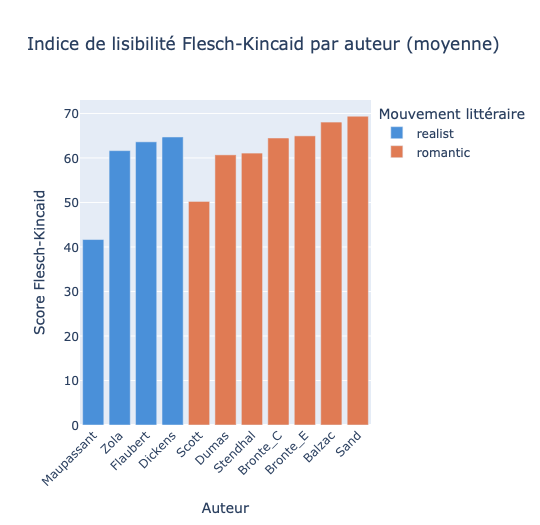
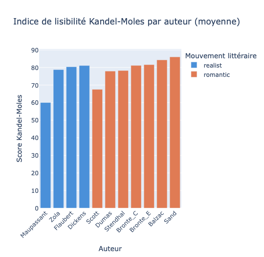
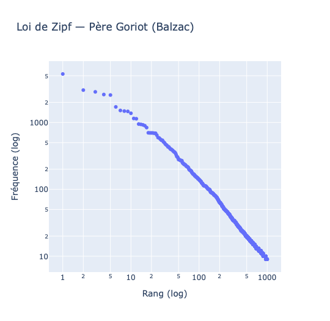
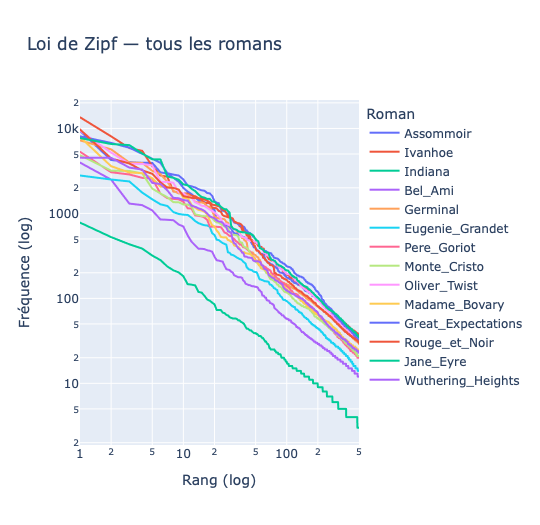
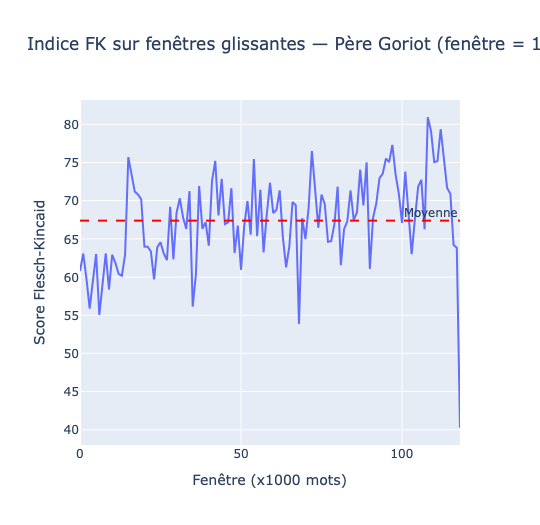
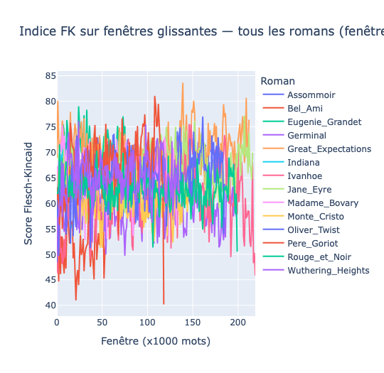
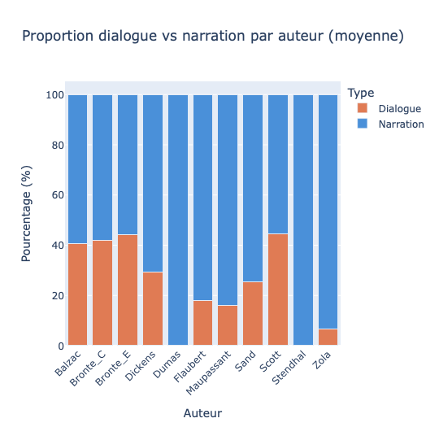
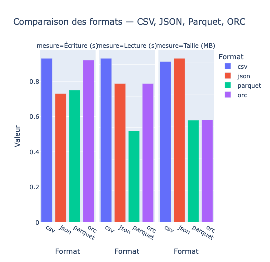

# Introduction — Description des données et pipeline d'extraction

## Corpus

Le corpus est composé de 14 romans du XIXe siècle répartis en deux 
mouvements littéraires : le **Romantisme** (Balzac, Dumas, Stendhal, 
Sand, Brontë, Scott) et le **Réalisme** (Flaubert, Zola, Dickens, 
Maupassant). Les textes ont été téléchargés depuis 
[Project Gutenberg](https://www.gutenberg.org/) en version anglaise.

| Auteur | Titre | Mouvement | Mots |
|--------|-------|-----------|------|
| Balzac | Père Goriot | Romantique | 103 598 |
| Balzac | Eugénie Grandet | Romantique | 66 578 |
| Dumas | Le Comte de Monte-Cristo | Romantique | 121 587 |
| Stendhal | Le Rouge et le Noir | Romantique | 171 925 |
| Sand | Indiana | Romantique | 14 032 |
| Brontë C. | Jane Eyre | Romantique | 185 396 |
| Brontë E. | Wuthering Heights | Romantique | 115 949 |
| Scott | Ivanhoe | Romantique | 191 646 |
| Flaubert | Madame Bovary | Réaliste | 115 667 |
| Zola | Germinal | Réaliste | 164 610 |
| Zola | L'Assommoir | Réaliste | 155 848 |
| Dickens | Great Expectations | Réaliste | 184 482 |
| Dickens | Oliver Twist | Réaliste | 157 973 |
| Maupassant | Bel-Ami | Réaliste | 48 412 |

## Pipeline d'extraction

Le pipeline ETL télécharge automatiquement les romans depuis Project 
Gutenberg et supprime les en-têtes et pieds de page. Les fichiers sont 
sauvegardés dans Google Drive et ne sont pas commités dans le dépôt git.
Le code complet est disponible en annexe.

# Chargement et transformation

## Construction du DataFrame Spark

Les textes sont chargés dans un Spark DataFrame avec les métadonnées 
associées à chaque roman (auteur, titre, mouvement littéraire, langue, 
nombre de caractères, nombre de mots).

Le schéma du DataFrame est le suivant :

| Colonne | Type | Description |
|---------|------|-------------|
| `author` | String | Nom de l'auteur |
| `title` | String | Titre du roman |
| `movement` | String | `romantic` ou `realist` |
| `lang` | String | Langue (`en`) |
| `text` | String | Texte brut complet |
| `n_chars` | Long | Nombre de caractères |
| `n_words` | Long | Nombre de mots |

## Choix du format de stockage

Les DataFrames intermédiaires sont sauvegardés au format **Parquet**: 
un format orienté colonne qui offre de meilleures performances en lecture 
que CSV ou JSON, grâce à la compression Snappy et au pushdown de prédicats. 
Ce choix est justifié et comparé aux autres formats dans la partie 5.

# Annotation avec Spark-NLP

## Pipeline d'annotation

Nous utilisons Spark-NLP 5.5.3 avec PySpark 3.5.0. Le pipeline applique 
trois étapes successives sur chaque roman en parallèle :

1. **DocumentAssembler**: convertit le texte brut en document Spark-NLP
2. **SentenceDetector**: découpe le document en phrases
3. **Tokenizer**: découpe chaque phrase en mots

Le résultat est un DataFrame enrichi avec trois nouvelles colonnes :

| Colonne | Contenu |
|---------|---------|
| `document` | Le texte entier encapsulé dans le format Spark-NLP |
| `sentences` | Liste des phrases détectées |
| `tokens` | Liste des mots (tokens) avec leur position |

Le DataFrame annoté est sauvegardé en Parquet dans Google Drive pour 
éviter de relancer l'annotation à chaque session c'est l'opération
la plus longue du pipeline.

# Analyse Stylométrique

## Indices de lisibilité

Les indices de lisibilité mesurent quantitativement la difficulté de lecture 
d'un texte. Nous calculons deux indices : **Flesch-Kincaid** (FK) et 
**Kandel-Moles** (KM), tous deux basés sur la longueur des phrases et la 
complexité des mots.

### Flesch-Kincaid

$$FK = 206.835 - 1.015 \times \frac{mots}{phrases} - 84.6 \times \frac{syllabes}{mots}$$

Un score élevé indique un texte facile à lire. Les scores varient 
généralement entre 0 (très difficile) et 100 (très facile).

{fig-cap="Scores FK moyens par auteur, colorés par mouvement littéraire"}

Les scores FK obtenus sont globalement moyens (entre 40 et 70), cohérents 
avec des textes littéraires du XIXe siècle. **Maupassant** (41) et 
**Scott** (50) sont les plus difficiles à lire, tandis que **Sand** (69) 
et **Balzac** (68) sont les plus accessibles. On ne observe pas de 
séparation nette entre romantiques et réalistes.

### Kandel-Moles

$$KM = 207 - 1.015 \times \frac{mots}{phrases} - 73.6 \times \frac{syllabes}{mots}$$

L'indice de Kandel-Moles est une adaptation française du Flesch-Kincaid 
avec un coefficient des syllabes plus faible (73.6 vs 84.6), conçu pour 
les textes en français qui ont tendance à avoir des mots plus longs.



Les scores KM sont systématiquement plus élevés que FK — les deux indices 
donnent le même classement des auteurs.

## Loi de Zipf

La loi de Zipf stipule que dans tout corpus textuel, la fréquence d'un mot 
est inversement proportionnelle à son rang. Sur un graphique log-log, 
cette relation donne une droite de pente -1.



La courbe log-log de *Père Goriot* confirme la loi de Zipf, on observe 
une droite de pente négative quasi-parfaite.



Toutes les courbes sont quasi-parallèles, ce qui confirme que la loi de 
Zipf s'applique à l'ensemble du corpus. **Indiana** (Sand) se détache en 
dessous des autres en raison de sa taille réduite (14 000 mots).

## Fenêtres glissantes

Les indices calculés sur l'ensemble d'un roman masquent les variations 
internes du texte. Nous calculons FK sur des fenêtres de 1000 mots pour 
observer comment le style évolue au fil du roman.



Le score FK de *Père Goriot* oscille entre 55 et 80 autour d'une moyenne 
stable de 67. La chute en fin de roman correspond probablement à des 
passages plus denses.



Tous les romans ont un comportement similaire, les scores oscillent entre 
45 et 85 avec une moyenne autour de 65, indépendamment du mouvement 
littéraire.

## Dialogue vs Narration

La détection des dialogues s'est révélée plus complexe que prévu. Une 
première approche avec des guillemets standards `"..."` ne donnait aucun 
résultat. En inspectant le texte brut, nous avons découvert que Gutenberg 
utilise des guillemets typographiques unicode `\u201c` et `\u201d`. 
Par ailleurs, certains romans français (Germinal, Rouge et Noir, Monte 
Cristo) utilisent les tirets `—` pour les dialogues, ils affichent 
donc 0% de dialogue détecté.
Le caractère unicode 8220 correspond au guillemet typographique gauche `"` 
et non au guillemet ASCII standard `"` (code 34). Notre regex a été 
adaptée en conséquence.



Les romantiques anglais (Brontë, Scott, Balzac) ont les proportions de 
dialogue les plus élevées (40-47%), tandis que les réalistes français 
(Zola, Flaubert, Maupassant) sont plus narratifs (moins de 20%).


# Spark — Analyse des performances

## Comparaison des formats de fichiers

Spark peut lire et écrire des données dans plusieurs formats. Nous 
comparons ici **CSV**, **JSON**, **Parquet** et **ORC** sur trois critères :
temps d'écriture, temps de lecture et taille sur disque.



| Format  | Écriture (s) | Lecture (s) | Taille (MB) |
|---------|-------------|-------------|-------------|
| CSV     | 1.02        | 0.58        | 10.03       |
| JSON    | 0.69        | 0.59        | 10.23       |
| Parquet | 0.77        | 0.29        | 6.37        |
| ORC     | 0.92        | 0.46        | 6.39        |

**Parquet** est le meilleur format sur deux critères essentiels :

- **Lecture la plus rapide** (0.29s) — 2x plus rapide que CSV et JSON.
  C'est crucial car dans un pipeline Spark on lit les données bien plus
  souvent qu'on ne les écrit.
- **Taille la plus compacte** (6.37MB) — 37% plus léger que CSV grâce
  à la compression Snappy et au stockage orienté colonne.

**ORC** obtient des résultats similaires à Parquet, c'est un format 
équivalent, historiquement lié à l'écosystème Hive/Hadoop. CSV et JSON 
sont plus lents en lecture et occupent plus d'espace car ils ne tirent 
pas parti des optimisations de Spark.

## Cache et Persist

Par défaut Spark recalcule un DataFrame depuis le début à chaque action. 
Le mécanisme de **cache** permet de stocker un DataFrame en mémoire pour 
éviter ces recalculs.

| Appel | Sans cache | Avec cache |
|-------|-----------|------------|
| 1er   | 0.22s     | 1.48s      |
| 2ème  | 0.21s     | 0.07s      |

Le 1er appel avec cache est plus lent, Spark doit lire le fichier ET 
le stocker en mémoire. Le 2ème appel est 3x plus rapide (0.07s vs 0.21s) 
car Spark lit directement depuis la mémoire. Le gain de 66.7% devient 
significatif quand on appelle le même DataFrame plusieurs fois comme 
`df_annotated` qui est utilisé pour FK, KM, Zipf, fenêtres glissantes 
et dialogue/narration.

## Identification des shuffles

Spark UI tourne sur `localhost:4040` et n'est pas accessible directement 
depuis Colab. Nous utilisons `df.explain()` qui affiche le plan 
d'exécution et permet d'identifier les shuffles.

Un shuffle se produit quand Spark doit redistribuer les données entre 
les partitions, c'est l'opération la plus coûteuse du pipeline.

```
== Physical Plan ==
AdaptiveSparkPlan isFinalPlan=false
+- HashAggregate(keys=[title, word], functions=[count(1)])
   +- Exchange hashpartitioning(title, word, 200)   ← SHUFFLE
      +- HashAggregate(keys=[title, word], functions=[partial_count(1)])
         +- Generate explode(tokens)
            +- Scan Parquet
```

Le shuffle critique se produit lors du `groupBy("title", "word")` du 
calcul Zipf, Spark doit rassembler tous les tokens identiques éparpillés 
dans les partitions pour les compter.

## Mitigation des shuffles

Nous réduisons `spark.sql.shuffle.partitions` de 200 (défaut) à 8 — 
plus adapté à notre corpus de 14 romans.

| Stratégie | Temps |
|-----------|-------|
| 200 partitions (défaut) | 318.99s |
| 8 partitions (optimisé) | 318.89s |

Le gain est négligeable sur notre corpus de 14 romans. Avec un corpus 
plus grand, la réduction du nombre de partitions aurait probablement 
un impact plus visible, car Spark passerait moins de temps à gérer des 
partitions vides.

# Appendice

## A1 — Installation et démarrage Spark

```{python}
#| echo: true
#| eval: false

!pip install pyspark==3.5.0
!pip install spark-nlp==5.5.3

import sparknlp
import requests
import re
import time
import os
from pathlib import Path
from pyspark.sql import functions as F
from pyspark.sql import types as T
from pyspark.ml import Pipeline
from sparknlp.base import DocumentAssembler
from sparknlp.annotator import SentenceDetector, Tokenizer
from pyspark.sql.functions import col, size, udf, explode, lower, count, posexplode, floor
from pyspark.sql.functions import round as spark_round, sum as spark_sum, row_number
from pyspark.sql.window import Window
import plotly.express as px

spark = sparknlp.start()
print("Spark-NLP:", sparknlp.version())
print("Spark:", spark.version)
```

## A2 — Montage Drive et ETL

```{python}
#| echo: true
#| eval: false

from google.colab import drive
drive.mount('/content/drive')

DATA_DIR = Path("/content/drive/MyDrive/projet_BD/DATA")
RAW_DIR = DATA_DIR / "raw_texts"
RAW_DIR.mkdir(parents=True, exist_ok=True)

GUTENBERG_URL = "https://www.gutenberg.org/cache/epub/{id}/pg{id}.txt"

CORPUS = [
    {"author": "Balzac",     "title": "Pere_Goriot",          "id": 1237,  "movement": "romantic", "lang": "en"},
    {"author": "Balzac",     "title": "Eugenie_Grandet",       "id": 1608,  "movement": "romantic", "lang": "en"},
    {"author": "Dumas",      "title": "Monte_Cristo",          "id": 17989, "movement": "romantic", "lang": "en"},
    {"author": "Stendhal",   "title": "Rouge_et_Noir",         "id": 798,   "movement": "romantic", "lang": "en"},
    {"author": "Sand",       "title": "Indiana",               "id": 5837,  "movement": "romantic", "lang": "en"},
    {"author": "Bronte_C",   "title": "Jane_Eyre",             "id": 1260,  "movement": "romantic", "lang": "en"},
    {"author": "Bronte_E",   "title": "Wuthering_Heights",     "id": 768,   "movement": "romantic", "lang": "en"},
    {"author": "Scott",      "title": "Ivanhoe",               "id": 82,    "movement": "romantic", "lang": "en"},
    {"author": "Flaubert",   "title": "Madame_Bovary",         "id": 2413,  "movement": "realist",  "lang": "en"},
    {"author": "Zola",       "title": "Germinal",              "id": 5711,  "movement": "realist",  "lang": "en"},
    {"author": "Zola",       "title": "Assommoir",             "id": 8600,  "movement": "realist",  "lang": "en"},
    {"author": "Dickens",    "title": "Great_Expectations",    "id": 1400,  "movement": "realist",  "lang": "en"},
    {"author": "Dickens",    "title": "Oliver_Twist",          "id": 730,   "movement": "realist",  "lang": "en"},
    {"author": "Maupassant", "title": "Bel_Ami",               "id": 4598,  "movement": "realist",  "lang": "en"},
]

def clean_gutenberg(text):
    start = re.search(r"\*\*\* START OF TH(IS|E) PROJECT GUTENBERG", text)
    end   = re.search(r"\*\*\* END OF TH(IS|E) PROJECT GUTENBERG",   text)
    if start and end:
        text = text[start.end():end.start()]
    return text.strip()

def download_all():
    for book in CORPUS:
        path = RAW_DIR / book["author"] / f"{book['title']}.txt"
        path.parent.mkdir(parents=True, exist_ok=True)
        if path.exists():
            print(f"[cache] {book['title']}")
            continue
        url = GUTENBERG_URL.format(id=book["id"])
        response = requests.get(url, timeout=30)
        text = clean_gutenberg(response.text)
        path.write_text(text, encoding="utf-8")
        print(f"[ok] {book['title']} — {len(text):,} caractères")
        time.sleep(1)

download_all()
```

## A3 — Construction du DataFrame Spark

```{python}
#| echo: true
#| eval: false

from pyspark.sql.types import StructType, StructField, StringType, LongType

rows = []
for author_dir in RAW_DIR.iterdir():
    if not author_dir.is_dir():
        continue
    author = author_dir.name
    for txt_file in author_dir.glob("*.txt"):
        title = txt_file.stem
        text = txt_file.read_text(encoding="utf-8")
        movement = next(b["movement"] for b in CORPUS if b["title"] == title)
        lang = next(b["lang"] for b in CORPUS if b["title"] == title)
        rows.append((author, title, movement, lang, text, len(text), len(text.split())))

schema = StructType([
    StructField("author",   StringType(), True),
    StructField("title",    StringType(), True),
    StructField("movement", StringType(), True),
    StructField("lang",     StringType(), True),
    StructField("text",     StringType(), True),
    StructField("n_chars",  LongType(),   True),
    StructField("n_words",  LongType(),   True),
])

df = spark.createDataFrame(rows, schema=schema)
df.write.mode("overwrite").parquet(str(DATA_DIR / "corpus_raw.parquet"))
```

## A4 — Annotation Spark-NLP

```{python}
#| echo: true
#| eval: false

document_assembler = DocumentAssembler() \
    .setInputCol("text") \
    .setOutputCol("document")

sentence_detector = SentenceDetector() \
    .setInputCols(["document"]) \
    .setOutputCol("sentences")

tokenizer = Tokenizer() \
    .setInputCols(["sentences"]) \
    .setOutputCol("tokens")

pipeline = Pipeline(stages=[
    document_assembler,
    sentence_detector,
    tokenizer
])

model = pipeline.fit(df)
df_annotated = model.transform(df)
df_annotated.write.mode("overwrite").parquet(str(DATA_DIR / "corpus_annotated.parquet"))
```

## A5 — Indices de lisibilité FK et KM

```{python}
#| echo: true
#| eval: false

from pyspark.sql.types import LongType

def compute_syllables(text):
    if text is None:
        return 0
    vowels = "aeiouyAEIOUY"
    count = 0
    prev_vowel = False
    for char in text:
        is_vowel = char in vowels
        if is_vowel and not prev_vowel:
            count += 1
        prev_vowel = is_vowel
    return count

syllable_udf = udf(compute_syllables, LongType())

df_annotated = spark.read.parquet(str(DATA_DIR / "corpus_annotated.parquet"))

df_fk = df_annotated \
    .withColumn("n_sentences", size(col("sentences"))) \
    .withColumn("n_syllables", syllable_udf(col("text"))) \
    .withColumn("flesch_kincaid", spark_round(
        206.835
        - 1.015 * (col("n_words") / col("n_sentences"))
        - 84.6  * (col("n_syllables") / col("n_words")), 2)) \
    .withColumn("kandel_moles", spark_round(
        207
        - 1.015 * (col("n_words") / col("n_sentences"))
        - 73.6  * (col("n_syllables") / col("n_words")), 2))
```

## A6 — Loi de Zipf

```{python}
#| echo: true
#| eval: false

df_words_all = df_annotated.select(
    "title", "author",
    explode("tokens").alias("token")
).select(
    "title", "author",
    lower(col("token.result")).alias("word")
).filter(col("word").rlike("^[a-z]+$"))

df_freq_all = df_words_all.groupBy("title", "author", "word") \
                          .agg(count("*").alias("freq"))

window = Window.partitionBy("title").orderBy(col("freq").desc())
df_zipf_all = df_freq_all.withColumn("rank", row_number().over(window))
```

## A7 — Fenêtres glissantes

```{python}
#| echo: true
#| eval: false

from pyspark.sql.types import IntegerType

WINDOW_SIZE = 1000

def count_syllables_word(word):
    if word is None:
        return 0
    vowels = "aeiouyAEIOUY"
    count_s = 0
    prev_vowel = False
    for char in word.lower():
        is_vowel = char in vowels
        if is_vowel and not prev_vowel:
            count_s += 1
        prev_vowel = is_vowel
    return max(1, count_s)

syllable_word_udf = udf(count_syllables_word, IntegerType())

df_tokens_all = df_annotated.select(
    "title", "author", "movement",
    posexplode("tokens").alias("pos", "token")
).select(
    "title", "author", "movement",
    col("pos"),
    col("token.result").alias("word")
)

df_windows_all = df_tokens_all \
    .filter(col("word").rlike("^[a-zA-Z]+$")) \
    .withColumn("window_id", floor(col("pos") / WINDOW_SIZE)) \
    .withColumn("syllables", syllable_word_udf(col("word")))

df_sliding_all = df_windows_all.groupBy("title", "author", "movement", "window_id") \
    .agg(count("*").alias("n_words"), spark_sum("syllables").alias("n_syllables")) \
    .withColumn("n_sentences_est", (col("n_words") / 15).cast("double")) \
    .withColumn("flesch_kincaid", spark_round(
        206.835
        - 1.015 * (col("n_words") / col("n_sentences_est"))
        - 84.6  * (col("n_syllables") / col("n_words")), 2))
```

## A8 — Dialogue vs Narration

```{python}
#| echo: true
#| eval: false

from pyspark.sql.types import StructType, StructField, IntegerType

def extract_dialog(text):
    if text is None:
        return 0, 0
    import re
    dialogs = re.findall(r'[\u201c"]([^\u201d"]*)[\u201d"]', text)
    dialogs += re.findall(r'(?m)^[—–-]\s(.+)$', text)
    dialog_chars = sum(len(d) for d in dialogs)
    total_chars = len(text)
    return int(dialog_chars), int(total_chars)

dialog_schema = StructType([
    StructField("dialog_chars", IntegerType()),
    StructField("total_chars",  IntegerType())
])
dialog_udf = udf(extract_dialog, dialog_schema)

df_dialog = df_annotated \
    .withColumn("dialog_stats", dialog_udf(col("text"))) \
    .withColumn("dialog_chars", col("dialog_stats.dialog_chars")) \
    .withColumn("total_chars", col("dialog_stats.total_chars")) \
    .withColumn("dialog_pct", spark_round(
        col("dialog_chars") / col("total_chars") * 100, 2)) \
    .withColumn("narration_pct", spark_round(100 - col("dialog_pct"), 2))
```

## A9 — Benchmark des formats

```{python}
#| echo: true
#| eval: false

import time
import shutil

BENCH_DIR = DATA_DIR / "benchmarks"
BENCH_DIR.mkdir(parents=True, exist_ok=True)

def benchmark_format(fmt, df):
    path = str(BENCH_DIR / fmt)
    if Path(path).exists():
        shutil.rmtree(path)
    start = time.perf_counter()
    if fmt == "csv":
        df.write.mode("overwrite").csv(path, header=True)
    elif fmt == "json":
        df.write.mode("overwrite").json(path)
    elif fmt == "parquet":
        df.write.mode("overwrite").parquet(path)
    elif fmt == "orc":
        df.write.mode("overwrite").orc(path)
    write_time = round(time.perf_counter() - start, 2)
    size_mb = round(sum(
        f.stat().st_size for f in Path(path).rglob("*") if f.is_file()
    ) / 1024 / 1024, 2)
    start = time.perf_counter()
    if fmt == "csv":
        spark.read.csv(path, header=True).count()
    elif fmt == "json":
        spark.read.json(path).count()
    elif fmt == "parquet":
        spark.read.parquet(path).count()
    elif fmt == "orc":
        spark.read.orc(path).count()
    read_time = round(time.perf_counter() - start, 2)
    return {"format": fmt, "write_seconds": write_time,
            "read_seconds": read_time, "size_mb": size_mb}

df_bench = spark.read.parquet(str(DATA_DIR / "corpus_raw.parquet"))
results = [benchmark_format(fmt, df_bench) for fmt in ["csv", "json", "parquet", "orc"]]
```

## A10 — Cache et shuffles

```{python}
#| echo: true
#| eval: false

# Cache
df_cached = spark.read.parquet(str(DATA_DIR / "corpus_annotated.parquet")).cache()
df_cached.count()
df_cached.unpersist()

# Shuffles
spark.conf.set("spark.sql.shuffle.partitions", "8")
df_freq_all.count()
spark.conf.set("spark.sql.shuffle.partitions", "200")
```

## A11 — Pipelines graphiques

```{python}
#| echo: true
#| eval: false

import plotly.express as px
import pandas as pd

# FK et KM
df_plot = df_fk.select("author", "title", "movement", 
                        "flesch_kincaid", "kandel_moles").toPandas()
df_avg = df_plot.groupby(["author", "movement"], as_index=False).agg(
    flesch_kincaid=("flesch_kincaid", "mean"),
    kandel_moles=("kandel_moles", "mean")
).round(2)

fig = px.bar(df_avg.sort_values("flesch_kincaid"),
    x="author", y="flesch_kincaid", color="movement",
    title="Indice de lisibilité Flesch-Kincaid par auteur (moyenne)",
    labels={"flesch_kincaid": "Score Flesch-Kincaid",
            "author": "Auteur", "movement": "Mouvement littéraire"},
    color_discrete_map={"romantic": "#e07b54", "realist": "#4a90d9"})
fig.update_layout(xaxis_tickangle=-45)
fig.show()

fig2 = px.bar(df_avg.sort_values("kandel_moles"),
    x="author", y="kandel_moles", color="movement",
    title="Indice de lisibilité Kandel-Moles par auteur (moyenne)",
    labels={"kandel_moles": "Score Kandel-Moles",
            "author": "Auteur", "movement": "Mouvement littéraire"},
    color_discrete_map={"romantic": "#e07b54", "realist": "#4a90d9"})
fig2.update_layout(xaxis_tickangle=-45)
fig2.show()

# Zipf — Père Goriot
window = Window.orderBy(col("freq").desc())
df_zipf = df_freq.withColumn("rank", row_number().over(window))
df_zipf_pd = df_zipf.toPandas()
fig3 = px.scatter(df_zipf_pd.head(1000),
    x="rank", y="freq", log_x=True, log_y=True,
    title="Loi de Zipf — Père Goriot (Balzac)",
    labels={"rank": "Rang (log)", "freq": "Fréquence (log)"})
fig3.show()

# Zipf — tous les romans
df_zipf_pd_all = df_zipf_all.filter(col("rank") <= 500).toPandas()
fig4 = px.line(df_zipf_pd_all.sort_values("rank"),
    x="rank", y="freq", color="title",
    log_x=True, log_y=True,
    title="Loi de Zipf — tous les romans",
    labels={"rank": "Rang (log)", "freq": "Fréquence (log)", "title": "Roman"})
fig4.show()

# Fenêtres glissantes — Père Goriot
df_sliding_pd = df_sliding.orderBy("window_id").toPandas()
fig5 = px.line(df_sliding_pd,
    x="window_id", y="flesch_kincaid",
    title="Indice FK sur fenêtres glissantes — Père Goriot (fenêtre = 1000 mots)",
    labels={"window_id": "Fenêtre (x1000 mots)", 
            "flesch_kincaid": "Score Flesch-Kincaid"})
fig5.add_hline(y=df_sliding_pd["flesch_kincaid"].mean(),
    line_dash="dash", line_color="red", annotation_text="Moyenne")
fig5.show()

# Fenêtres glissantes — tous les romans
df_sliding_pd_all = df_sliding_all.orderBy("title", "window_id").toPandas()
fig6 = px.line(df_sliding_pd_all,
    x="window_id", y="flesch_kincaid", color="title",
    title="Indice FK sur fenêtres glissantes — tous les romans (fenêtre = 1000 mots)",
    labels={"window_id": "Fenêtre (x1000 mots)",
            "flesch_kincaid": "Score Flesch-Kincaid", "title": "Roman"})
fig6.show()

# Dialogue vs narration
df_dialog_pd = df_dialog.select("author", "title", "movement", 
                                 "dialog_pct", "narration_pct").toPandas()
df_dialog_avg = df_dialog_pd.groupby(["author", "movement"], as_index=False).agg(
    dialog_pct=("dialog_pct", "mean"),
    narration_pct=("narration_pct", "mean")
).round(2)
df_melted = df_dialog_avg.melt(
    id_vars=["author", "movement"],
    value_vars=["dialog_pct", "narration_pct"],
    var_name="type", value_name="percentage")
df_melted["type"] = df_melted["type"].map({
    "dialog_pct": "Dialogue", "narration_pct": "Narration"})
fig7 = px.bar(df_melted.sort_values("author"),
    x="author", y="percentage", color="type",
    title="Proportion dialogue vs narration par auteur (moyenne)",
    labels={"percentage": "Pourcentage (%)", "author": "Auteur", "type": "Type"},
    color_discrete_map={"Dialogue": "#e07b54", "Narration": "#4a90d9"})
fig7.update_layout(xaxis_tickangle=-45, barmode="stack")
fig7.show()

# Benchmark formats
bench_long = benchmark_pd.melt(
    id_vars=["format"],
    value_vars=["write_seconds", "read_seconds", "size_mb"],
    var_name="mesure", value_name="valeur")
bench_long["mesure"] = bench_long["mesure"].map({
    "write_seconds": "Écriture (s)",
    "read_seconds": "Lecture (s)",
    "size_mb": "Taille (MB)"})
fig8 = px.bar(bench_long,
    x="format", y="valeur", color="format", facet_col="mesure",
    title="Comparaison des formats — CSV, JSON, Parquet, ORC",
    labels={"valeur": "Valeur", "format": "Format"})
fig8.update_yaxes(matches=None)
fig8.show()

# Cache benchmark
df_test = spark.read.parquet(str(DATA_DIR / "corpus_annotated.parquet"))
start = time.perf_counter()
df_test.count()
t1 = round(time.perf_counter() - start, 2)
start = time.perf_counter()
df_test.count()
t2 = round(time.perf_counter() - start, 2)
print(f"Sans cache — 1er appel : {t1}s | 2ème appel : {t2}s")

df_cached = spark.read.parquet(str(DATA_DIR / "corpus_annotated.parquet")).cache()
start = time.perf_counter()
df_cached.count()
t3 = round(time.perf_counter() - start, 2)
start = time.perf_counter()
df_cached.count()
t4 = round(time.perf_counter() - start, 2)
print(f"Avec cache — 1er appel : {t3}s | 2ème appel : {t4}s")
print(f"Gain : {round((t2 - t4) / t2 * 100, 1)}%")
df_cached.unpersist()

# Shuffles — explain
df_freq_all.explain()

# Mitigation shuffles
start = time.perf_counter()
df_freq_all.count()
t_before = round(time.perf_counter() - start, 2)
spark.conf.set("spark.sql.shuffle.partitions", "8")
start = time.perf_counter()
df_freq_all.count()
t_after = round(time.perf_counter() - start, 2)
print(f"Sans optimisation : {t_before}s")
print(f"Avec optimisation : {t_after}s")
spark.conf.set("spark.sql.shuffle.partitions", "200")
```