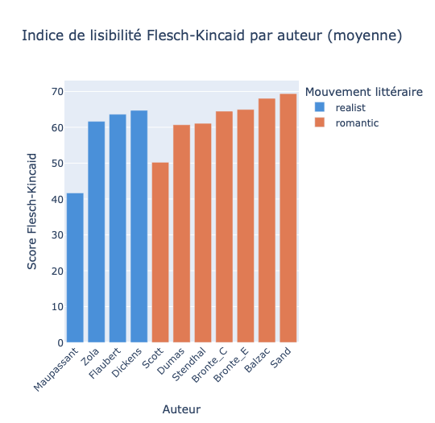
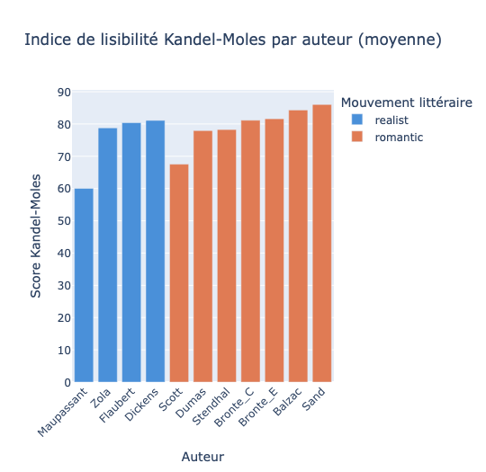
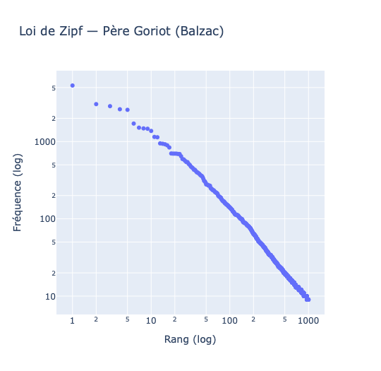
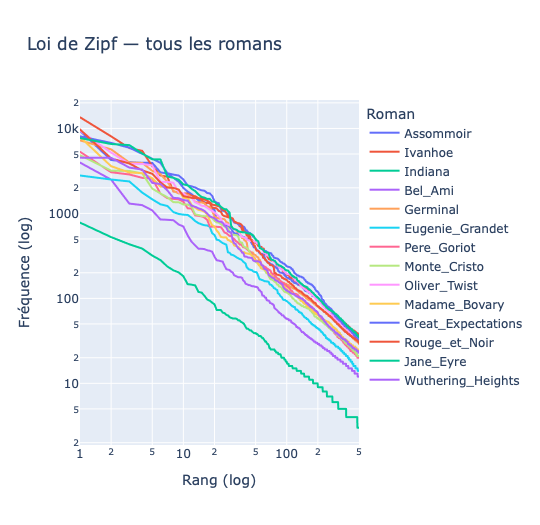
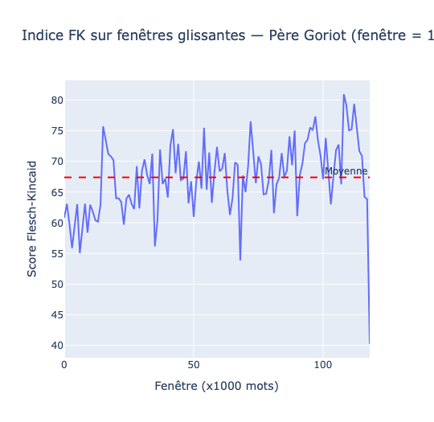
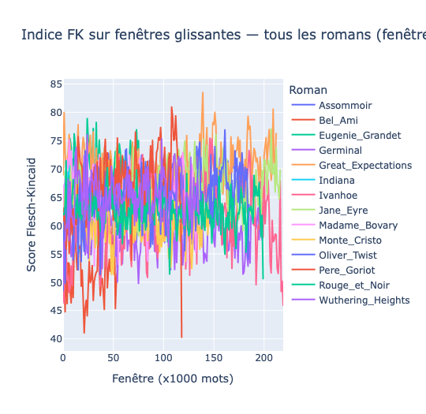
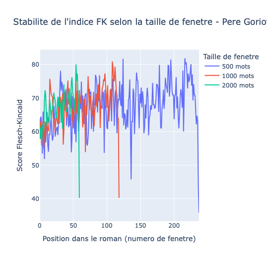
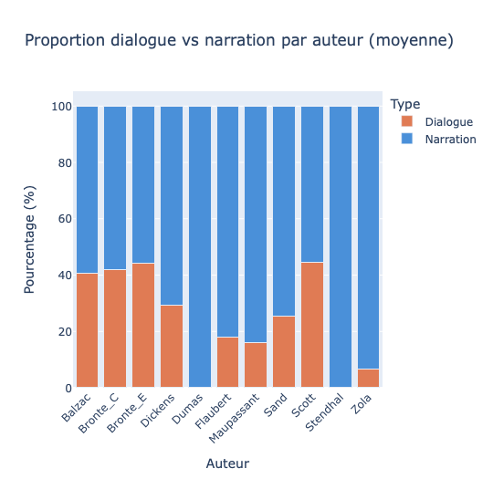
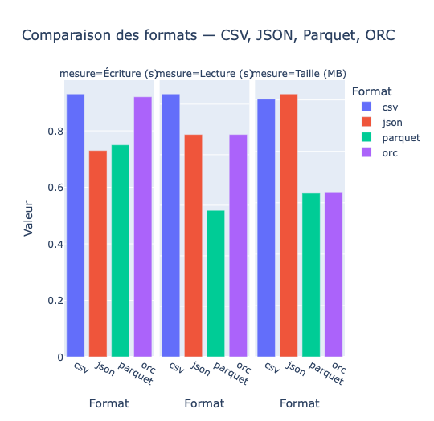

## Plan

1. Introduction et corpus
2. Pipeline d'extraction
3. Construction du DataFrame Spark
4. Annotation avec Spark-NLP
5. Analyse stylométrique
6. Analyse des performances Spark
7. Conclusion

---

# Introduction

## Objectif du projet

Ce projet construit un pipeline complet de traitement de texte avec Spark, depuis l'extraction de romans du XIXe siècle jusqu'à l'analyse stylométrique.

Les textes sont comparés selon deux mouvements littéraires :

- **Romantisme** : Balzac, Dumas, Stendhal, Sand, Brontë, Scott
- **Réalisme** : Flaubert, Zola, Dickens, Maupassant

L'objectif est double :

- tester un pipeline Spark-NLP sur un corpus littéraire ;
- mesurer des indicateurs de style : lisibilité, loi de Zipf, variations internes, dialogue vs narration.

---

## Corpus {.smaller}

Le corpus contient **14 romans** téléchargés depuis [Project Gutenberg](https://www.gutenberg.org/) en version anglaise.

| Auteur | Titre | Mouvement | Mots |
|---|---|---|---:|
| Balzac | Père Goriot | Romantique | 103 598 |
| Balzac | Eugénie Grandet | Romantique | 66 578 |
| Dumas | Le Comte de Monte-Cristo | Romantique | 121 587 |
| Stendhal | Le Rouge et le Noir | Romantique | 171 925 |
| Sand | Indiana | Romantique | 14 032 |
| Brontë C. | Jane Eyre | Romantique | 185 396 |
| Brontë E. | Wuthering Heights | Romantique | 115 949 |
| Scott | Ivanhoe | Romantique | 191 646 |
| Flaubert | Madame Bovary | Réaliste | 115 667 |
| Zola | Germinal | Réaliste | 164 610 |
| Zola | L'Assommoir | Réaliste | 155 848 |
| Dickens | Great Expectations | Réaliste | 184 482 |
| Dickens | Oliver Twist | Réaliste | 157 973 |
| Maupassant | Bel-Ami | Réaliste | 48 412 |

---

# Pipeline d'extraction

## Extraction des textes

Le pipeline ETL automatise la récupération des textes depuis Project Gutenberg.

Étapes principales :

1. définition d'une liste de métadonnées : auteur, titre, identifiant Gutenberg, mouvement, langue ;
2. téléchargement de chaque roman ;
3. suppression des en-têtes et pieds de page Gutenberg ;
4. sauvegarde des textes nettoyés dans Google Drive ;
5. exclusion des textes bruts du dépôt git.

Cette étape garantit que le corpus peut être reconstruit sans stocker directement les romans dans le projet.

---

## Logique du pipeline

```text
Project Gutenberg
        |
        v
Téléchargement automatique
        |
        v
Nettoyage des marqueurs START/END
        |
        v
Fichiers texte sur Google Drive
        |
        v
DataFrame Spark
```

Le nettoyage retire les blocs standardisés ajoutés par Gutenberg afin de conserver uniquement le contenu littéraire.

---

# Chargement et transformation

## Construction du DataFrame Spark

Chaque texte est chargé dans un DataFrame Spark avec ses métadonnées.

Le DataFrame permet ensuite :

- d'associer chaque roman à son auteur et à son mouvement ;
- de conserver le texte complet dans une colonne `text` ;
- de calculer les grandeurs de base : caractères et mots ;
- de rendre les traitements NLP parallélisables.

---

## Schéma du DataFrame {.smaller}

| Colonne | Type | Description |
|---|---|---|
| `author` | String | Nom de l'auteur |
| `title` | String | Titre du roman |
| `movement` | String | `romantic` ou `realist` |
| `lang` | String | Langue du texte (`en`) |
| `text` | String | Texte brut complet |
| `n_chars` | Long | Nombre de caractères |
| `n_words` | Long | Nombre de mots |

Le choix de Spark permet de conserver une structure tabulaire claire tout en manipulant des textes longs.

---

## Choix du format de stockage

Les DataFrames intermédiaires sont sauvegardés en **Parquet**.

Pourquoi Parquet ?

- format orienté colonne ;
- compression Snappy ;
- lecture plus rapide que CSV et JSON ;
- pushdown de prédicats ;
- format très adapté aux pipelines Spark.

Ce choix est validé plus loin par le benchmark des formats.

---

# Annotation avec Spark-NLP

## Pipeline d'annotation

Le pipeline utilise **Spark-NLP 5.5.3** avec **PySpark 3.5.0**.

Trois étapes sont appliquées à chaque roman :

1. **DocumentAssembler** : transforme le texte brut en document Spark-NLP ;
2. **SentenceDetector** : découpe le document en phrases ;
3. **Tokenizer** : découpe les phrases en mots.

L'annotation est l'opération la plus longue du pipeline. Le résultat est donc sauvegardé en Parquet pour éviter de relancer cette étape à chaque session.

---

## DataFrame annoté

| Colonne | Contenu |
|---|---|
| `document` | Texte entier encapsulé dans le format Spark-NLP |
| `sentences` | Liste des phrases détectées |
| `tokens` | Liste des mots avec leur position |

Ce DataFrame annoté devient la base commune des analyses :

- indices FK et KM ;
- loi de Zipf ;
- fenêtres glissantes ;
- dialogue vs narration ;
- mesures de performance.

---

# Analyse stylométrique

## Indices de lisibilité

Les indices de lisibilité mesurent la difficulté de lecture d'un texte.

Deux indices sont calculés :

- **Flesch-Kincaid (FK)** ;
- **Kandel-Moles (KM)**.

Ils reposent sur deux dimensions :

- la longueur moyenne des phrases ;
- la complexité des mots, approximée par le nombre de syllabes.

---

## Flesch-Kincaid

$$
FK = 206.835 - 1.015 \times \frac{mots}{phrases}
- 84.6 \times \frac{syllabes}{mots}
$$

Un score élevé indique un texte plus facile à lire.

Résultats principaux :

- les scores varient entre **41** pour Maupassant et **69** pour Sand et Balzac ;
- les réalistes obtiennent une moyenne légèrement plus basse, autour de **57** ;
- les romantiques sont autour de **62** ;
- Maupassant et Scott apparaissent comme les textes les plus complexes.

---

## Flesch-Kincaid par auteur

{fig-alt="Scores Flesch-Kincaid moyens par auteur"}

::: {.notes}
Si l'image n'apparaît pas, placer le dossier `images` du rapport à côté de ce fichier `slides.qmd`.
:::

---

## Analyse FK

Plusieurs points doivent être nuancés :

- **Sand** obtient le score le plus élevé, mais *Indiana* est aussi le roman le plus court du corpus ;
- un texte court peut donner un style plus homogène et donc un score plus stable ;
- **Scott** est pénalisé par un style historique dense et descriptif ;
- l'écart entre mouvements existe, mais il ne suffit pas à séparer nettement romantisme et réalisme.

---

## Kandel-Moles

$$
KM = 207 - 1.015 \times \frac{mots}{phrases}
- 73.6 \times \frac{syllabes}{mots}
$$

Kandel-Moles est une adaptation française du Flesch-Kincaid.

Différence principale :

- le coefficient des syllabes est plus faible : **73.6** au lieu de **84.6** ;
- les mots longs sont donc moins pénalisés ;
- les scores KM sont mécaniquement plus élevés.

---

## Kandel-Moles par auteur

{fig-alt="Scores Kandel-Moles moyens par auteur"}

Les scores KM sont environ **17 points plus élevés** que les scores FK.

Le classement des auteurs reste identique, ce qui confirme la cohérence entre les deux indices. Dans ce projet, KM est cependant à interpréter avec prudence car les textes analysés sont en anglais.

---

## Loi de Zipf

La loi de Zipf affirme que la fréquence d'un mot est inversement proportionnelle à son rang.

Sur un graphique log-log :

- les mots les plus fréquents sont au début ;
- la fréquence diminue régulièrement ;
- la relation prend la forme d'une droite de pente négative.

Cette loi permet de vérifier la structure statistique globale du corpus.

---

## Zipf - Père Goriot

{fig-alt="Courbe log-log de Zipf pour Père Goriot"}

La courbe de *Père Goriot* confirme la loi de Zipf : on observe une relation presque linéaire en échelle log-log.

Les mots les plus fréquents sont principalement des mots fonctionnels anglais : *the*, *to*, *of*, *a*, *and*.

---

## Zipf - tous les romans

{fig-alt="Courbes de Zipf pour tous les romans"}

La loi de Zipf est vérifiée pour tous les romans.

Analyse :

- une pente plus raide indique un vocabulaire plus concentré ;
- une pente plus douce indique un vocabulaire plus varié ;
- *Indiana* présente des fréquences plus basses à rang égal, ce qui reflète sa taille réduite.

---

## Fenêtres glissantes

Les scores calculés sur un roman entier masquent les variations internes.

Les fenêtres glissantes permettent d'observer l'évolution du style au fil du texte.

Question principale :

> À partir de quelle taille de fenêtre l'indice devient-il stable ?

Trois tailles sont comparées :

- 500 mots ;
- 1000 mots ;
- 2000 mots.

---

## FK glissant - Père Goriot

{fig-alt="Indice Flesch-Kincaid par fenêtre dans Père Goriot"}

Le score FK de *Père Goriot* oscille entre **55** et **80**, autour d'une moyenne stable proche de **67**.

La chute en fin de roman correspond probablement à des passages plus denses.

---

## FK glissant - tous les romans

{fig-alt="Indice Flesch-Kincaid par fenêtre pour tous les romans"}

Tous les romans suivent un comportement comparable :

- oscillations entre environ **45** et **85** ;
- moyenne autour de **65** ;
- absence de séparation nette entre les deux mouvements.

---

## Stabilité selon la taille de fenêtre {.smaller}

{fig-alt="Comparaison des tailles de fenêtre pour Père Goriot"}

| Taille de fenêtre | Moyenne | Écart-type | Min | Max |
|---|---:|---:|---:|---:|
| 500 mots | 67.40 | 6.84 | 35.84 | 81.84 |
| 1000 mots | 67.39 | 6.00 | 40.26 | 80.93 |
| 2000 mots | 67.14 | 5.86 | 40.26 | 80.00 |

---

## Analyse des fenêtres

Plus la fenêtre est grande, plus la courbe est lisse.

Résultat important :

- la moyenne reste presque identique quelle que soit la taille ;
- la granularité change, mais pas le style global ;
- une fenêtre de **1000 mots** constitue le meilleur compromis.

Elle capture les variations stylistiques sans être trop sensible au bruit local.

---

## Dialogue vs narration

La détection des dialogues a été plus complexe que prévu.

Problèmes rencontrés :

- les guillemets ASCII `"..."` ne détectaient presque rien ;
- Gutenberg utilise souvent des guillemets typographiques Unicode ;
- certains romans français utilisent des tirets pour les dialogues ;
- ces conventions typographiques peuvent produire des faux zéros.

La regex a donc été adaptée aux guillemets typographiques et aux tirets.

---

## Dialogue vs narration par auteur

{fig-alt="Proportion de dialogue et de narration par auteur"}

Les résultats distinguent surtout les conventions typographiques et les traditions narratives.

Les romantiques anglais présentent des proportions de dialogue élevées, tandis que plusieurs réalistes français privilégient la narration.

---

## Analyse dialogue / narration

Observations principales :

- **Brontë C.**, **Brontë E.**, **Scott** et **Balzac** atteignent environ **40 à 44 %** de dialogue ;
- **Zola**, **Flaubert** et **Maupassant** ont des proportions plus faibles, autour de **13 à 17 %** ;
- **Germinal**, **Le Rouge et le Noir** et **Monte-Cristo** affichent parfois **0 %** à cause des conventions de tirets ;
- **Indiana** se situe entre les deux groupes, autour de **25 %**.

Cette partie montre que l'analyse stylométrique dépend aussi fortement du prétraitement typographique.

---

# Spark - Analyse des performances

## Configuration de la session Spark

La configuration par défaut de `sparknlp.start()` est peu transparente.

Le projet configure explicitement Spark :

```text
Spark version : 3.5.0
Cores disponibles : 2
shuffle.partitions : 8
```

Paramètres clés :

- `local[*]` pour utiliser tous les cores disponibles ;
- `spark.driver.memory = 8g` pour éviter les erreurs mémoire ;
- `spark.sql.shuffle.partitions = 8` pour adapter Spark à un petit corpus.

---

## Comparaison des formats

Spark peut lire et écrire plusieurs formats.

Formats comparés :

- CSV ;
- JSON ;
- Parquet ;
- ORC.

Critères mesurés :

- temps d'écriture ;
- temps de lecture ;
- taille sur disque.

---

## Benchmark des formats {.smaller}

{fig-alt="Benchmark CSV JSON Parquet ORC"}

| Format | Écriture (s) | Lecture (s) | Taille (MB) |
|---|---:|---:|---:|
| CSV | 1.02 | 0.58 | 10.03 |
| JSON | 0.69 | 0.59 | 10.23 |
| Parquet | 0.77 | 0.29 | 6.37 |
| ORC | 0.92 | 0.46 | 6.39 |

---

## Analyse des formats

**Parquet** est le meilleur choix dans ce projet.

Raisons :

- lecture la plus rapide : **0.29 s** ;
- environ deux fois plus rapide que CSV et JSON en lecture ;
- taille la plus compacte : **6.37 MB** ;
- environ **37 %** plus léger que CSV ;
- format natif et optimisé pour Spark.

ORC obtient des résultats proches, mais Parquet reste plus simple et plus standard dans ce pipeline.

---

## Cache et persist

Par défaut, Spark recalcule un DataFrame à chaque action.

Le cache stocke un DataFrame en mémoire pour éviter ces recalculs.

| Appel | Sans cache | Avec cache |
|---|---:|---:|
| 1er | 0.22 s | 1.48 s |
| 2ème | 0.21 s | 0.07 s |

Le premier appel avec cache est plus lent car Spark doit lire puis stocker les données. Le deuxième appel est environ **3 fois plus rapide**.

---

## Quand le cache devient utile

Le cache est rentable lorsque le même DataFrame est réutilisé plusieurs fois.

Dans ce projet, c'est le cas de `df_annotated`, utilisé pour :

- FK ;
- KM ;
- Zipf ;
- fenêtres glissantes ;
- dialogue / narration.

Le gain devient donc significatif sur l'ensemble du pipeline, même si le premier appel est plus coûteux.

---

## Checkpointing

Le cache et le persist ne coupent pas le **lineage** Spark.

Le lineage correspond à la chaîne de recalcul que Spark conserve pour reconstruire un DataFrame en cas d'échec.

Le checkpoint :

- sauvegarde le DataFrame sur Drive ou HDFS ;
- coupe réellement le lineage ;
- rend les étapes suivantes plus robustes ;
- évite des plans d'exécution trop profonds.

---

## Cache, persist, checkpoint {.smaller}

| Mécanisme | Stockage | Survit à crash | Coupe lineage | Usage typique |
|---|---|---|---|---|
| `cache()` | RAM | Non | Non | DataFrame réutilisé plusieurs fois |
| `persist(DISK_ONLY)` | Disque local | Partiel | Non | DataFrame trop lourd pour la RAM |
| `checkpoint()` | Drive / HDFS | Oui | Oui | Pipeline long, lineage trop profond |

Dans le projet, le checkpoint est appliqué juste après l'annotation NLP, c'est-à-dire au point le plus profond du pipeline.

---

## Niveaux de persist {.smaller}

| Niveau | 1er appel | 2ème appel |
|---|---:|---:|
| MEMORY_ONLY | 1.30 s | 0.20 s |
| MEMORY_AND_DISK | 2.26 s | 0.31 s |
| DISK_ONLY | 1.41 s | 0.23 s |

Analyse :

- `MEMORY_ONLY` est le plus rapide ici car le corpus tient en RAM ;
- `MEMORY_AND_DISK` serait plus robuste avec moins de mémoire ;
- le bon niveau dépend de la taille des données et du cluster.

---

## Identification des shuffles

Un shuffle se produit quand Spark redistribue les données entre partitions.

Dans ce projet, le shuffle critique apparaît dans le calcul de Zipf :

```text
HashAggregate(keys=[title, word], functions=[count(1)])
  Exchange hashpartitioning(title, word, 200)  <- SHUFFLE
    HashAggregate(keys=[title, word], functions=[partial_count(1)])
      Generate explode(tokens)
        Scan Parquet
```

Le `groupBy("title", "word")` oblige Spark à rassembler les tokens identiques.

---

## Mitigation des shuffles

Première stratégie : réduire le nombre de partitions de shuffle.

| Stratégie | Temps |
|---|---:|
| 200 partitions par défaut | 318.99 s |
| 8 partitions optimisées | 318.89 s |

Le gain est négligeable sur ce corpus.

Interprétation :

- 14 romans restent un petit volume pour Spark ;
- la réduction des partitions évite des partitions vides ;
- mais elle ne change pas fondamentalement le coût du calcul.

---

## Stratégies supplémentaires {.smaller}

| Stratégie | Temps (s) | Gain |
|---|---:|---:|
| 200 partitions par défaut | 318.99 | - |
| 8 partitions | 318.89 | ~0 % |
| `repartition(14, "title")` | 2.31 | -27.6 % |
| broadcast join | 1.04 | 35.8 % |

Le `repartition()` est contre-productif ici car il ajoute un shuffle avant le `groupBy`.

Le **broadcast join** est la mitigation la plus efficace : les métadonnées ne contiennent que 14 lignes et peuvent être envoyées à chaque executor.

---

## Spark-NLP vs SpaCy

La comparaison avec SpaCy n'a pas été réalisée par manque de temps.

Lecture qualitative :

- SpaCy offre une API simple et des modèles pré-entraînés récents ;
- Spark-NLP s'intègre mieux à un pipeline Spark distribué ;
- pour un corpus beaucoup plus grand, Spark-NLP devient plus pertinent ;
- pour une analyse locale plus légère, SpaCy serait probablement plus rapide à mettre en place.

---

# Conclusion

## Bilan technique

Le projet a permis de construire un pipeline complet :

- extraction depuis Gutenberg ;
- nettoyage ;
- DataFrame Spark ;
- annotation Spark-NLP ;
- stockage Parquet ;
- analyses stylométriques ;
- mesures de performance Spark.

Spark s'est montré adapté au traitement parallèle du corpus, surtout grâce au stockage Parquet, au cache et au checkpoint.

---

## Bilan stylométrique

Les analyses confirment plusieurs tendances :

- les indices FK et KM restent cohérents entre eux ;
- la loi de Zipf est vérifiée sur tout le corpus ;
- les fenêtres glissantes montrent une stabilité globale du style ;
- le dialogue vs narration révèle l'importance des conventions typographiques.

En revanche, les résultats ne montrent pas de séparation nette et automatique entre romantisme et réalisme.

---

## Message final

Deux leçons principales ressortent.

Sur le plan Spark :

> Il faut mesurer avant d'optimiser : une stratégie pertinente sur un grand corpus peut être inutile, voire négative, sur un petit corpus.

Sur le plan littéraire :

> Les indicateurs quantitatifs éclairent les tendances stylistiques, mais ils doivent être interprétés avec les limites du corpus et du prétraitement.

---

## Annexes possibles

Le rapport contient également le code complet pour :

- l'installation de Spark et Spark-NLP ;
- l'ETL Gutenberg ;
- la construction du DataFrame ;
- le pipeline d'annotation ;
- les calculs FK, KM, Zipf, fenêtres glissantes ;
- la détection dialogue / narration ;
- les benchmarks et optimisations Spark.

Ces blocs peuvent être ajoutés en backup slides si nécessaire.
